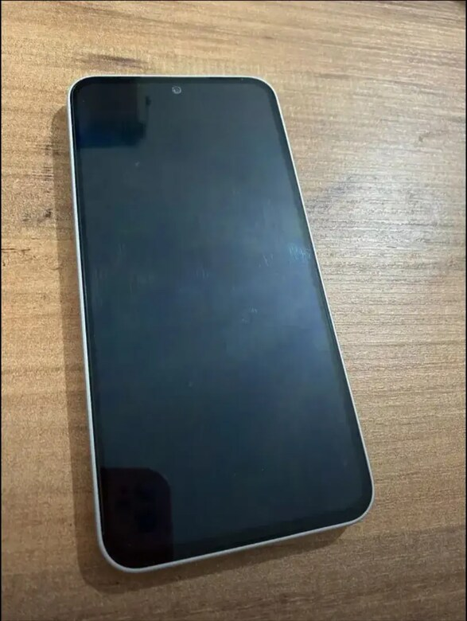
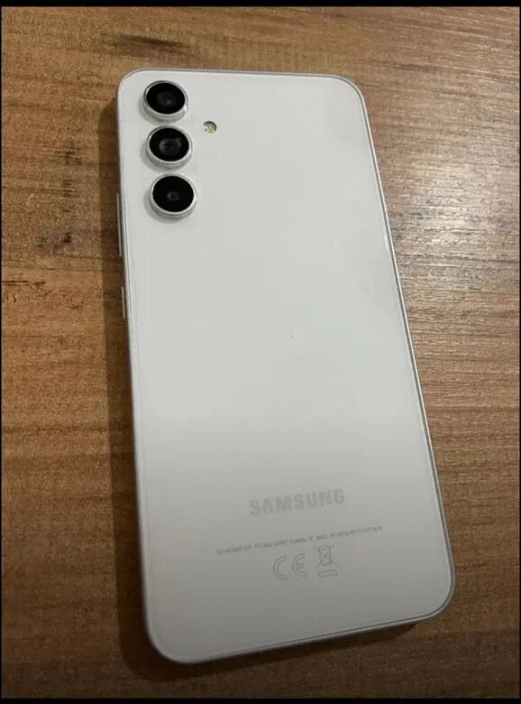

# 01 — Görsel değerlendirme

CihazAnaliz’in ön ve arka cihaz fotoğraflarını inceleyen bölümü. Amaç, cihazın kozmetik durumu ve türünü değerlendirmek, ilgili işlev testine yönlendirmek ve gelecekteki otomat/kiosk kabul akışına veri sağlamaktır.

## Mevcut akış

1. Ürün adı, ön yüz ve arka yüz fotoğrafı yüklenir.
2. Fotoğraflar Gemini üzerinden ayrı ayrı analiz edilir; cihaz türü, marka/model tahmini, kozmetik puanı ve gözlemler alınır.
3. Mevcut kod ön yüz puanını %60, arka yüz puanını %40 ağırlıkla birleştirir.
4. Ürün için dış kaynaklardan fiyat bilgisi aranır ve prototip fiyat hesabı yapılır.
5. Uygun telefon/klavye/gamepad/kulaklık/fare testine bağlantı sunulur.

Gemini kullanılan servis olarak korunur. Fotoğraftan tespit ve fiyat çıktıları model/tahmin sonuçlarıdır; kesin cihaz ekspertizi veya garanti edilmiş fiyat değildir. API ve fiyat kaynaklarının kullanılabilirliği ayrıca gerekir.

## Kurulum

Depo kökünden, etkin bir Python sanal ortamıyla:

```powershell
python -m pip install -r 01-gorsel-degerlendirme/requirements.txt
$env:GEMINI_API_KEY = "KENDI_ANAHTARINIZ"
python 01-gorsel-degerlendirme/main.py
```

Panel `http://localhost:5001`, alt testler 5002–5006 portlarındadır. `GEMINI_API_KEY` önceliklidir; alternatif yerel anahtar dosyası için `Your_Gemini_Api_Key.example.txt` örneği bulunur. Gerçek anahtar dosyası Git dışında kalır. Selenium kullanılan fiyat akışları tarayıcı/sürücü gerektirebilir.

**02-islev-testleri ile aynı anda çalıştırmayın:** portlar çakışır. Bu düzenleme iki uygulamayı tek süreçte birleştirmez.

## Örnek ön / arka fotoğraf

| Ön yüz | Arka yüz |
| --- | --- |
|  |  |

`ON-ARKA-FOTO/` içinde telefon, klavye, fare, kulaklık ve gamepad örnekleri vardır. Bunlar depoda önceden bulunan örnek fotoğraflardır; yeni bir API analizi bu düzenleme sırasında yapılmadı.

## Dosyalar

- `main.py`: fotoğraf analizi, arayüz, fiyat akışı ve alt test başlatıcısı.
- `phone_info.py`, `keyboard_tester.py`, `gamepad_tester.py`, `headphone_tester.py`, `mouse_tester.py`: yönlendirilen işlev testleri.
- `requirements.txt`: bu bölümün bağımlılıkları.

Fiziksel fotoğraf kabini, motor/kilit, otomatik ürün teslimi veya ödeme entegrasyonu mevcut kodun tamamlanmış özellikleri değildir.

[Ana README](../README.md) · [İşlev testleri](../02-islev-testleri/README.md)
