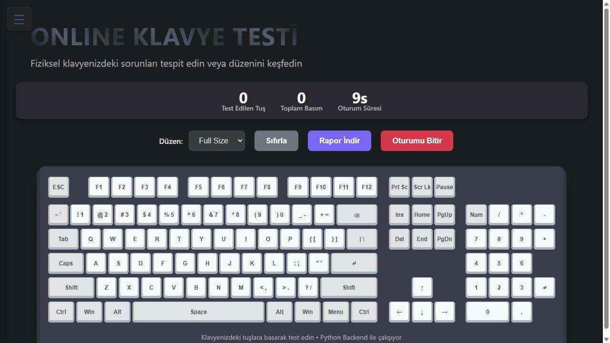
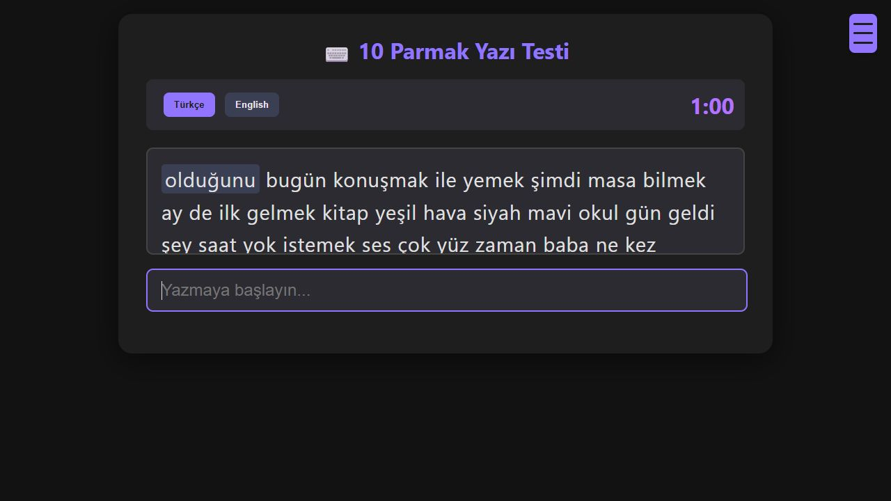

# ReTurn

Telefon ve bilgisayar çevre birimlerini değerlendirmek için Python/Flask tabanlı test araçları.

| Uygulama | İçerik | Ana adres |
| --- | --- | --- |
| [Test Merkezi](apps/test-merkezi) | Fiyat/kozmetik değerlendirme, telefon, klavye, gamepad, PC, ses, ekran, fare, dokunmatik, internet, yazma ve kamera | http://localhost:5000 |
| [Gemini](apps/gemini) | Gemini destekli ürün değerlendirmesi ve beş çevre birimi testi | http://localhost:5001 |

Amaç, farklı cihaz kontrollerini tek ana panelden açmak ve telefon/çevre birimi değerlendirmesini düzenli bir akışta yürütmektir.

## Görseller

Uygulama yerelde çalıştırılarak alınan dört ekran görüntüsü.

### Test Merkezi ana paneli


### Klavye test ekranı



### Fare test ekranı


### Yazma hızı testi




## Kurulum

Windows üzerinde Python 3.11 veya 3.12 önerilir. PC sensör paneli WMI ve .NET/DLL kullanır. Donanım testleri uygun cihaz ve tarayıcı izinleri gerektirir; bütün modüllerin her işletim sisteminde çalıştığı doğrulanmamıştır.

Depo kökünde PowerShell ile:

```powershell
py -3.11 -m venv .venv
.\.venv\Scripts\python.exe -m pip install -r apps/test-merkezi/requirements.txt
.\.venv\Scripts\python.exe apps/test-merkezi/main.py
```

Kamera modülü için aşağıdaki sertifika adımını tamamlayın. Diğer modüller bağımsız başlatılabilir: `python apps/test-merkezi/keyboard_tester.py`.

### Gemini uygulaması

Ayrı sanal ortam kullanabilirsiniz. Bağımlılıkları yükleyin ve kendi API anahtarınızı ortam değişkeniyle verin:

```powershell
.\.venv\Scripts\python.exe -m pip install -r apps/gemini/requirements.txt
$env:GEMINI_API_KEY = "KENDI_ANAHTARINIZ"
.\.venv\Scripts\python.exe apps/gemini/main.py
```

Alternatif olarak `apps/gemini/Your_Gemini_Api_Key.example.txt` dosyasını aynı klasörde `Your_Gemini_Api_Key.txt` adına kopyalayıp düzenleyin. Gerçek anahtar Git tarafından dışlanır. Kod `google.genai` kullandığı için bağımlılık `google-genai` paketidir.

**İki uygulamayı aynı anda başlatmayın:** 5001–5006 portları ortak kullanılır. Test Merkezi alt servisleri 5001–5012, Gemini alt servisleri 5002–5006 portlarındadır.

### Kamera ve yerel HTTPS

Kamera servisi `apps/test-merkezi/localhost.pem` ve `localhost-key.pem` dosyalarını bekler. Güvendiğiniz kaynaktan kurduğunuz [mkcert](https://github.com/FiloSottile/mkcert) ile bilgisayarınızda yeni sertifika üretin:

```powershell
mkcert -install
mkcert -cert-file apps/test-merkezi/localhost.pem -key-file apps/test-merkezi/localhost-key.pem localhost 127.0.0.1 ::1
```

Ardından `https://localhost:5012` adresini kullanın. Telefon/LAN kullanımı ayrıca doğru sertifika adresleri, güven zinciri ve tarayıcı izinleri gerektirir. Depoda eskiden paylaşılan özel anahtarı yeniden kullanmayın; bu düzenleme geçmiş commitlerden anahtarı silmez.

## Klasör yapısı

```text
apps/test-merkezi/   On iki test servisi, ana panel, model ve DLL dosyaları
apps/gemini/         Gemini paneli, beş test ve örnek görseller
docs/               Eski/yeni dosya haritası ve sürüm rehberi
scripts/            Kaynak kontrolü ve sürüm araçları
```

[Dosya taşıma haritası](docs/DOSYA_TASIMA.md) eski isimlerin karşılığını gösterir. Başlatıcı ve model yolları artık uygulama klasöründen türetilir; Windows kullanıcı adı düzenlemek gerekmez.

## Doğrulama ve sınırlar

`python scripts/check_source.py` Python sözdizimini, başlatıcı hedeflerini ve bağımlılık dosyalarının biçimini kontrol eder. Bu kontrol gerçek kamera, gamepad, mikrofon, WMI, Selenium veya Gemini kabul testi değildir.

Bazı Flask servisleri mevcut kodda debug ve LAN dinleme ayarları kullanır. Araçlar kişisel geliştirme/test içindir; internet sunucusu olarak yayımlamayın. Fiyat ve kozmetik model çıktıları garantili ekspertiz veya fiyat değildir. Eğitimli model yüklenemediğinde mevcut kod yer tutucu model kullanır.

## Sürümler ve lisans

[Değişiklikler](CHANGELOG.md) · [Sürüm rehberi](docs/SURUMLEME.md)

Depoya proje lisansı eklenmedi; üçüncü taraf DLL, model ve araçların dağıtım koşulları ayrıca değerlendirilmelidir.
