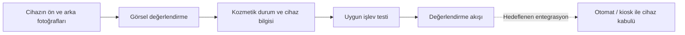
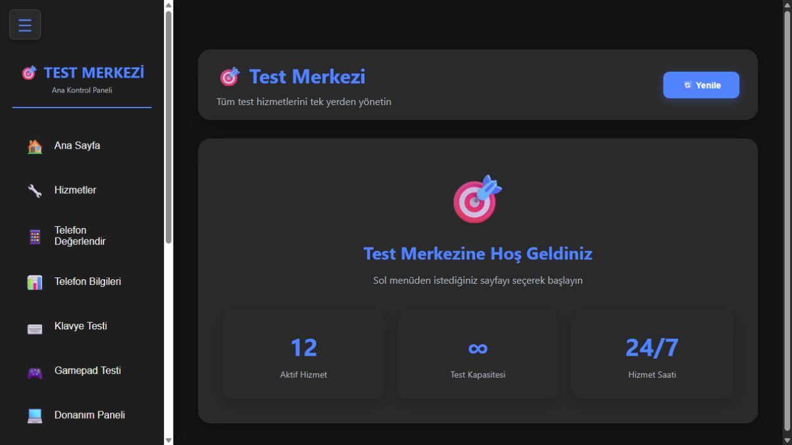
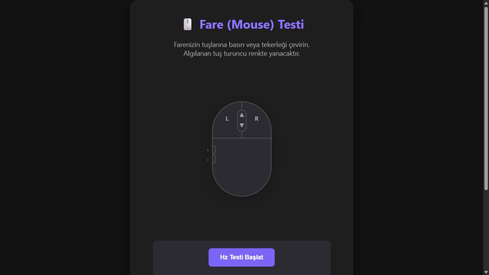

# CihazAnaliz

**Cihazın ön ve arka fotoğraflarını değerlendirerek görsel incelemeyi ve işlev testlerini bir cihaz kabul akışında birleştiren Python/Flask prototipi.** Projenin hedefi, cihazların bir otomat/kiosk üzerinden değerlendirilmesine temel oluşturmaktır.

Mevcut yazılım; fotoğraf yükleme, kozmetik değerlendirme, ürün/fiyat bilgisi ve cihaz türüne uygun işlev testlerini içerir. Fiziksel otomatik fotoğraf çekimi, mekanik cihaz kabulü veya ödeme/teslim otomasyonu bu depoda tamamlanmış özellik olarak sunulmaz.

| Bölüm | İçerik | Ana adres |
| --- | --- | --- |
| [01 — Görsel değerlendirme](01-gorsel-degerlendirme/README.md) | Ön/arka fotoğrafların analizi, cihaz türü ve kozmetik puanı, fiyat bilgisi ve uygun teste yönlendirme | http://localhost:5001 |
| [02 — İşlev testleri](02-islev-testleri/README.md) | Telefon, klavye, gamepad, PC, ses, ekran, fare, dokunmatik, internet, yazma ve kamera araçları; ek fiyat/kozmetik modülü | http://localhost:5000 |

Gemini, görsel değerlendirme bölümünün kullandığı analiz servisidir; projenin veya bölümün adı değildir. İki bölüm aynı prototipin parçalarıdır; ortak portlar nedeniyle mevcut sürümde aynı anda çalıştırılmaz.



## Görseller

Önceki sürüm yerelde çalıştırılarak alınan dört ekran görüntüsü. Görsellerde önceki arayüz adı görülebilir; yeni bölüm adı İşlev Testleri’dir.

### İşlev testleri ana paneli



### Klavye test ekranı


### Fare test ekranı



### Yazma hızı testi


## Kurulum

Windows üzerinde Python 3.11 veya 3.12 önerilir. PC sensör paneli WMI ve .NET/DLL kullanır. Donanım testleri uygun cihaz ve tarayıcı izinleri gerektirir; bütün modüllerin her işletim sisteminde çalıştığı doğrulanmamıştır.

Depo kökünde PowerShell ile:

```powershell
py -3.11 -m venv .venv
.\.venv\Scripts\python.exe -m pip install -r 02-islev-testleri/requirements.txt
.\.venv\Scripts\python.exe 02-islev-testleri/main.py
```

Kamera modülü için aşağıdaki sertifika adımını tamamlayın. Diğer modüller bağımsız başlatılabilir: `python 02-islev-testleri/keyboard_tester.py`.

### Görsel değerlendirme uygulaması

Ayrı sanal ortam kullanabilirsiniz. Bağımlılıkları yükleyin ve kendi API anahtarınızı ortam değişkeniyle verin:

```powershell
.\.venv\Scripts\python.exe -m pip install -r 01-gorsel-degerlendirme/requirements.txt
$env:GEMINI_API_KEY = "KENDI_ANAHTARINIZ"
.\.venv\Scripts\python.exe 01-gorsel-degerlendirme/main.py
```

Alternatif olarak `01-gorsel-degerlendirme/Your_Gemini_Api_Key.example.txt` dosyasını aynı klasörde `Your_Gemini_Api_Key.txt` adına kopyalayıp düzenleyin. Gerçek anahtar Git tarafından dışlanır. Kod `google.genai` kullandığı için bağımlılık `google-genai` paketidir.

**İki uygulamayı aynı anda başlatmayın:** 5001–5006 portları ortak kullanılır. İşlev Testleri alt servisleri 5001–5012, Görsel Değerlendirme alt servisleri 5002–5006 portlarındadır.

### Kamera ve yerel HTTPS

Kamera servisi `02-islev-testleri/localhost.pem` ve `localhost-key.pem` dosyalarını bekler. Güvendiğiniz kaynaktan kurduğunuz [mkcert](https://github.com/FiloSottile/mkcert) ile bilgisayarınızda yeni sertifika üretin:

```powershell
mkcert -install
mkcert -cert-file 02-islev-testleri/localhost.pem -key-file 02-islev-testleri/localhost-key.pem localhost 127.0.0.1 ::1
```

Ardından `https://localhost:5012` adresini kullanın. Telefon/LAN kullanımı ayrıca doğru sertifika adresleri, güven zinciri ve tarayıcı izinleri gerektirir. Depoda eskiden paylaşılan özel anahtarı yeniden kullanmayın; bu düzenleme geçmiş commitlerden anahtarı silmez.

## Klasör yapısı

```text
01-gorsel-degerlendirme/  Ön/arka görsellerden cihaz değerlendirmesi
02-islev-testleri/       Cihaz ve çevre birimi işlev kontrolleri
README.md                Sistem tanıtımı ve başlangıç rehberi
maintenance/             Ortak dokümanlar, görseller ve yayın araçları
```

[Dosya taşıma haritası](maintenance/docs/DOSYA_TASIMA.md) eski isimlerin karşılığını gösterir. Başlatıcı ve model yolları artık uygulama klasöründen türetilir; Windows kullanıcı adı düzenlemek gerekmez.

## Doğrulama ve sınırlar

`python maintenance/scripts/check_source.py` Python sözdizimini, başlatıcı hedeflerini ve bağımlılık dosyalarının biçimini kontrol eder. Bu kontrol gerçek kamera, gamepad, mikrofon, WMI, Selenium veya Gemini kabul testi değildir.

Bazı Flask servisleri mevcut kodda debug ve LAN dinleme ayarları kullanır. Araçlar kişisel geliştirme/test içindir; internet sunucusu olarak yayımlamayın. Fiyat ve kozmetik model çıktıları garantili ekspertiz veya fiyat değildir. Eğitimli model yüklenemediğinde mevcut kod yer tutucu model kullanır.

## Sürümler ve lisans

[Değişiklikler](CHANGELOG.md) · [Sürüm rehberi](maintenance/docs/SURUMLEME.md)

Depoya proje lisansı eklenmedi; üçüncü taraf DLL, model ve araçların dağıtım koşulları ayrıca değerlendirilmelidir.
